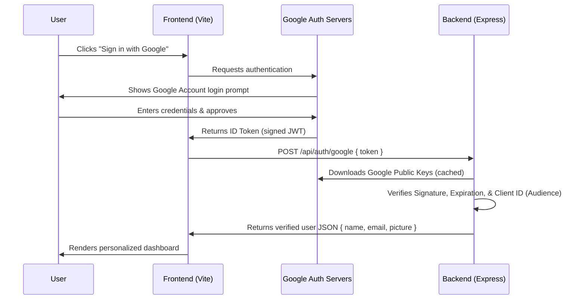

# Google OAuth 2.0 Full-Stack Authentication

This is a premium Google Authentication sign-in simulation and full-stack implementation. It features both a simulated OAuth flow for local prototyping and a secure Express-backed integration that validates actual Google credentials.

## 🚀 Running the Project

Both the front-end and back-end are active and running locally on your system:
* **Front-end (Vite)**: [http://localhost:5173/](http://localhost:5173/)
* **Back-end (Express)**: [http://localhost:5000/](http://localhost:5000/)

---

## 🛠️ How to Configure Real Google OAuth 2.0

To enable real Google account sign-ins, you must generate a Client ID from the Google Developer Console. Follow these instructions:

### Step 1: Create a Google Cloud Project
1. Open the [Google Cloud Console](https://console.cloud.google.com/).
2. Click the project dropdown list and click **New Project**. Name your project (e.g., `Google Login Demo`) and select **Create**.

### Step 2: Configure the OAuth Consent Screen
1. In the left navigation menu, click **APIs & Services** > **OAuth consent screen**.
2. Choose **External** (or **Internal** if you have a Google Workspace organization) and click **Create**.
3. Fill out the required App details (App Name, User Support Email, Developer Contact Info). Click **Save and Continue**.
4. Skip the **Scopes** and **Test Users** steps (unless you want to add specific test emails).

### Step 3: Create OAuth 2.0 Credentials
1. Navigate to **APIs & Services** > **Credentials**.
2. Click **+ Create Credentials** at the top and select **OAuth client ID**.
3. Set the **Application type** to **Web application**.
4. In the **Authorized JavaScript origins** section, click **+ ADD URI** and enter:
   ```text
   http://localhost:5173
   ```
5. Click **Create**. Copy the **Client ID** generated in the popup dialog.

### Step 4: Add the Client ID to the Application

You can configure the Client ID in one of two ways:

#### Option A: Through the Browser Settings (No Server Restart Required)
1. Open the application: [http://localhost:5173/](http://localhost:5173/).
2. Click the **Gear icon** (top-right corner) to open the **OAuth Configuration** panel.
3. Paste your Client ID and click **Save Settings**.
4. The page will reload and render the official native **"Sign in with Google"** button.

#### Option B: Through Environment Variables (Secure Backend Configuration)
1. Open the **[.env](file:///C:/Users/hp/google-auth-login/.env)** file in your editor.
2. Insert your Google Client ID:
   ```env
   GOOGLE_CLIENT_ID=your-copied-client-id-here.apps.googleusercontent.com
   ```
3. Restart the backend server. The backend will now enforce token validation against this Client ID.

---

## 🔒 Security Architecture

This project implements industry standard, production-ready OAuth token verification:



1. **Client Token Acquisition**: The Google Identity Services library prompts the login in a secure pop-up. Google returns a signed JSON Web Token (JWT) directly to the client browser.
2. **Backend Integrity Check**: The frontend passes this token to the Express API `/api/auth/google`. The server leverages Google's OAuth2 SDK to verify the token signature against Google's public signing keys, ensuring the token hasn't been forged, expired, or generated for a different application.
3. **Session Creation**: Once verified, the server authorizes the session and sends the verified data to the browser dashboard.
